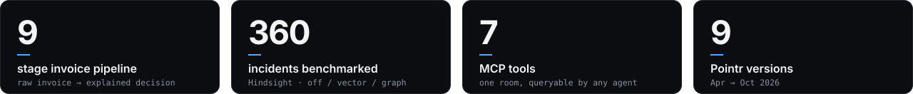
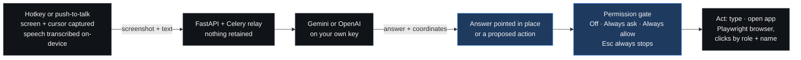
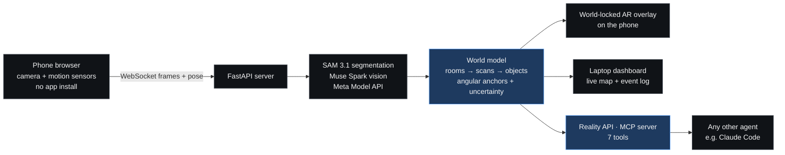
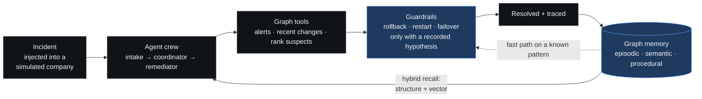

 

 

**I build software that perceives, remembers, and acts, then measure whether it actually works.**

Desktop assistants that read your screen. Agents with graph memory. Pipelines that turn messy documents into explainable decisions.

 

## Building right now

| | Project | State |
|:--|:--|:--|
| **Oct 2026** | [**Reality OS**](https://github.com/satvikydv/reality) | A phone-camera agent with spatial memory and an API for other agents. Solo entry to the Meta Global AI Developer Hackathon (Indie track). |
| **Oct 2026** | [**Hindsight**](https://github.com/satvikydv/hindsight) | An incident-response agent crew that learns playbooks into a shared graph memory, benchmarked against vector memory and no memory. |
| **Oct 2026** | [**Pointr v0.3.0**](https://github.com/satvikydv/pointr) | Shipped push-to-talk voice with on-device transcription. Ninth tagged version since April. |

## Pointr — ask your screen anything

*A Windows overlay that sees what's on your screen, answers in place, and can act for you, with your permission, every time.*

  

  <a href="https://www.pointr.duckdns.org"><b>Website</b></a> ·
  <a href="https://github.com/satvikydv/pointr/releases/latest"><b>Download</b></a> ·
  <a href="https://github.com/satvikydv/pointr"><b>Source</b></a> ·
  <a href="https://www.pointr.duckdns.org/privacy.html"><b>Privacy</b></a>

Press a hotkey anywhere and Pointr captures the screen, marks where your cursor is, and answers *pointing at the thing it's talking about*. Prefix a request with `explain:` for a narrated, drawn-on-screen walkthrough, or `agent:` and it will type into a field, open an app, or run a multi-step task across windows and a real browser.

- **Bring your own key.** Gemini, OpenAI, or both. No shared fallback key, so no request ever runs on someone else's account. The model list is fetched live from the key and filtered to models that can read a screenshot.
- **Privacy as architecture.** The backend is a relay, not a store. Speech is transcribed on-device, narration uses local text-to-speech, and telemetry is opt-in, anonymous and off by default.
- **Actions are earned, not assumed.** Three permission modes, a visible "here's what I'm about to do" confirmation, and Esc stops any run.
- **Browser automation that doesn't guess pixels.** Playwright clicks by accessibility role and name.
- **A real release cadence.** Nine versions from v0.0.1 (April 2026) to v0.3.0 (October), a public changelog, a Windows installer since v0.1.0, an update check and an AGPLv3 license.

`Rust` `Tauri 2` `FastAPI` `Celery` `Playwright` `Gemini` `OpenAI` `NVIDIA Parakeet`

## Reality OS — a camera-based memory of the physical world

*An agent that watches a room through a phone camera, remembers what's in it, guides you to things, and exposes that world to other agents over an API.*

Experimental prototype, in active development. [Source](https://github.com/satvikydv/reality)

- **An MCP server for a room.** `where_is("the thing I charge my laptop with")` returns a compass direction, neighbours, a photo reference and a confidence. `where_is` answers `found`, `not_seen` (with how much of the room the scan covered) or `unresolved`. Absence is reported as absence, not guessed.
- **AR without an AR framework.** Remembered objects are drawn where they are by projecting stored directions through the live phone pose. Segmentation masks are carried into the current view with the rotation-only homography `H = K·R·K⁻¹`, checked against a Python reference implementation by tests.
- **Deterministic memory.** Objects are recomputed from every stored detection in capture-time order, so results don't depend on which frame finished processing first. Every join and split decision is logged, and human corrections survive rebuilds.
- **Evaluated, not eyeballed.** A script scores the memory on synthetic rooms with known contents: duplicate rate, wrong merges, id switches, find success, order independence.
- **Consent enforced by a test.** The page never touches the camera, motion sensors or microphone on load. A test fails if it ever does.

`Python` `FastAPI` `WebSockets` `SAM 3.1` `MCP` `Computer vision` `Android + adb`

## Hindsight — incident response that remembers

*An agent crew that resolves production incidents and learns from each one, using a shared graph memory on FalkorDB.*

[Source](https://github.com/satvikydv/hindsight)

The question it exists to answer: **does graph memory actually beat vector memory for incident response?** So it ships with a benchmark harness that runs every incident in three modes (no memory, vector, graph) against simulator ground truth. Results from the saved scripted-policy run (360 incidents, 3 seeds, 32 benchmark + 8 held-out scenarios):

| | no memory | vector | **graph** |
|:--|--:|--:|--:|
| Recall@3 of a same-class past incident | n/a | 67% | **100%** |
| Fast path on repeat incidents | 0% | 0% | **96%** |
| Steps on repeat incidents | 9.16 | 9.16 | **7.20** |
| Harmful actions (incl. planted prompt-injection scenarios) | 0 | 0 | **0** |

> **Read this honestly:** that run used a scripted policy, not the language model. It validates the pipeline and graph mechanics and says nothing yet about real-model behavior, and the report says so in its first line. It also prints the targets it *missed* (step and token reductions fell short of the 40% and 30% goals). Running the real-model comparison is the next step. Publishing the misses is deliberate.

- **Three kinds of memory.** Episodic (incidents, actions), semantic (facts, with ownership corrections) and procedural (playbooks that store roles like `$top_caller` rather than service names, so they generalise).
- **Safe by construction.** Tool access is restricted per agent role, remediation requires a stated hypothesis, and a hard `--max-cost` cap plus a `--yes-spend` flag stop a benchmark from silently spending money.
- **Multi-tenant** with isolation tests, persisted simulator state, and an SSE live timeline.
- **A console that explains itself.** React + Cytoscape draws the memory graph with the cited recall path highlighted, plus playbooks and benchmark pages.

`Python 3.12` `FalkorDB` `FastAPI` `OpenAI` `MCP` `React` `Vite` `TypeScript` `Cytoscape`

## More shipped

<table>
<tr>
<td width="50%" valign="top">

**[Queryn](https://queryn-gold.vercel.app)** · [source](https://github.com/satvikydv/queryn) 
AI code intelligence for GitHub repos. Connect a repo, index it, then ask architecture questions, get commit summaries and keep a living knowledge base. Gemini-powered semantic search. 
`Next.js` `tRPC` `Prisma` `AI SDK` `Gemini`

</td>
<td width="50%" valign="top">

**[InvoiceIQ](https://github.com/satvikydv/invoice-pipeline)** 
Vendor invoices in, explainable decisions out. A 9-stage pipeline: Gemini Vision extraction, fuzzy vendor and PO matching, 5%-tolerance reconciliation, duplicate detection and risk scoring, ending in APPROVED / REVIEW REQUIRED / REJECTED with reasoning. 
`React` `FastAPI` `Gemini Vision` `rapidfuzz` `Docker`

</td>
</tr>
<tr>
<td width="50%" valign="top">

**[Ezply](https://github.com/satvikydv/ezply)** 
Job-application copilot. Discovers roles from public Greenhouse boards, ranks them against a saved resume, tailors content to the job description and autofills forms from a passphrase-encrypted local profile. The user approves before anything is submitted. 
`Python` `FastAPI` `SQLite`

</td>
<td width="50%" valign="top">

**[MSME Loan Voice Agent](https://github.com/satvikydv/voice-bot)** 
An outbound Vapi voice agent that qualifies small-business loan leads. Call webhooks flow into FastAPI, which extracts business type, vintage, turnover, amount and city. A Streamlit dashboard shows transcripts, recordings and funnel analytics. 
`Vapi` `FastAPI` `Streamlit` `MongoDB` `Docker`

</td>
</tr>
<tr>
<td width="50%" valign="top">

**[Empathy Engine](https://github.com/satvikydv/EmpathyEngine)** 
Text-to-speech that sounds like it understood the sentence. Emotion detection (VADER plus heuristics for surprise, concern and curiosity) drives rate and volume modulation. Chosen over fragile SSML so it plays reliably, offline, on any machine. 
`Python` `vaderSentiment` `pyttsx3`

</td>
<td width="50%" valign="top">

**[Pic Bay](https://pic-bay.onrender.com)** · **[Team Chat](https://github.com/satvikydv/team-chat-application)** 
An image-commerce platform with Razorpay payments, and a real-time team messaging app. Earlier full-stack builds in Next.js and TypeScript. 
`Next.js` `TypeScript` `Razorpay`

</td>
</tr>
</table>

Also in the lab: an [ESP32 weather-based irrigation controller](https://github.com/satvikydv/Weather-Based-Irrigation-System) (C++), [semantic movie-plot search](https://github.com/satvikydv/movie-search-assn), a [finance visualiser](https://github.com/satvikydv/finance-visualiser) and a [handwritten-digit recogniser](https://github.com/satvikydv/Handwritten-Digit-Recognition).

## How I build

| Principle | Evidence |
|:--|:--|
| **Measure it, then say what the numbers don't show** | Hindsight's benchmark report labels its own limits and lists the targets it missed. Reality OS scores its memory on synthetic rooms with known answers. |
| **Privacy is a design constraint, not a policy page** | Pointr: bring-your-own-key, a pass-through relay, on-device speech, opt-in telemetry. Ezply: passphrase-encrypted local storage. Reality OS: a test that fails if the camera starts on load. |
| **The human stays in control of actions** | Pointr's permission gate with Esc always honoured. Ezply keeps the user in the loop before submission. Hindsight's remediator can't act without a hypothesis. |
| **One source of truth, checked across languages** | Reality OS's coverage and projection maths live in Python and JavaScript and are tied together by golden tests. |
| **Every defect earns a test** | Hindsight's fixes land with a regression test each. Isolation, guardrail and traceability behaviour are tested, not assumed. |

## What I know

| Area | Hands-on with |
|:--|:--|
| **AI agents and tool use** | Multi-agent crews, tool-calling, guardrails, MCP servers, human-in-the-loop design, agent memory (episodic / semantic / procedural, graph and vector) |
| **Multimodal and voice** | Vision-language extraction, SAM segmentation, screen understanding, on-device speech recognition, text-to-speech, voice-agent platforms |
| **Backend** | FastAPI, Celery, SQLAlchemy, Node, tRPC, Prisma, SQLite, MongoDB, FalkorDB, WebSockets and SSE |
| **Frontend** | React, Next.js, Vite, TypeScript, Tailwind, Cytoscape, Recharts, Streamlit |
| **Desktop and systems** | Rust, Tauri 2, Playwright automation, Windows integration, C++ on ESP32 |
| **Shipping** | Docker, Vercel, Render, Razorpay payments, installers and release engineering |

  

## GitHub activity

  
  

 

**If you're working on agents, developer tools or document intelligence, I'd like to hear about it.**

[LinkedIn](https://www.linkedin.com/in/satvikydv/) · [Pointr](https://www.pointr.duckdns.org) · [Queryn](https://queryn-gold.vercel.app)

